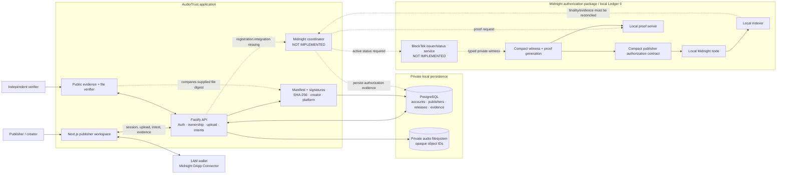

# BlockTek Radio / AudioTrust

**AudioTrust gives audio publishers portable, cryptographically verifiable release evidence.** A release record binds a publisher account, a signing intent, a canonical manifest, and the SHA-256 digest of the exact uploaded file. Public evidence lets another party verify the signatures and compare a file without signing into the publisher workspace.

AudioTrust does not determine whether audio is truthful, identify a real-world speaker, establish copyright ownership, prove legal identity without supporting evidence, or verify that a recording was authentic before registration.

## Project status

**Status: Local signed-release MVP slice implemented; complete Midnight-authorized release workflow is not yet ready.**

| Area | Current implementation status |
|---|---|
| Publisher accounts | Fastify/PostgreSQL account creation, login, session revocation, single-owner publisher onboarding, and ownership checks are implemented. Email verification and independent legal-identity verification are not configured. |
| Audio registration | Private filesystem upload, basic media signature/type checks, server-side SHA-256, durable signing intent and one-use nonce, manifest creation, creator signature verification, and development platform signing are implemented. |
| Wallet | The pinned Midnight DApp Connector 4.1.0 adapter is implemented and has 15 passing unit tests. A previous 1AM Preprod connection was manually confirmed, but live `signData` behavior and signing-key-to-address binding remain unverified. |
| Public verification | Public evidence, release history, original-file `MATCH`, modified-file `MISMATCH`, and a standalone evidence verification CLI are implemented. File equality proves exact byte equality only. |
| Compact authorization | The Compact 0.36 source passes the skip-ZK compile check and seven generated-runtime tests. A full compile generated current local proving/verifier artifacts. |
| Local Ledger 9 | The node, indexer, and proof server started successfully. A fresh deployment proof was generated and its transaction was accepted into the node mempool, but it did not finalize or appear in the indexer within 600 seconds. The integration run ended 5 failed / 0 passed; it is **not** a Ledger success. |
| API-to-Midnight flow | **Not implemented.** The API currently returns `awaiting_midnight`; there is no issuer status service, proof witness builder, transaction coordinator, finality/indexer reconciliation, or retry recovery path. Credential-wide revocation is not enforced by the current application. |

The local API workflow has been verified with an isolated development-only synthetic wallet. That check is not evidence of live 1AM compatibility or an on-chain authorization. See the [current milestone status](docs/roadmap/MILESTONE_STATUS.md), [test results](docs/backend/END_TO_END_TEST_RESULTS.md), and [fresh local Ledger attempt](docs/evidence/LOCAL_LEDGER_ATTEMPT_2026-11-22.md) for evidence and limits.

## High-level architecture



Solid paths are the current application boundaries. Dashed Midnight paths describe the intended authorization flow; the coordinator and issuer are not wired into the API. Audio files stay off-chain. The current Compact contract uses a request-specific replay nullifier and permits a signed status lease of up to 900 seconds; that lease does not by itself provide immediate credential-wide revocation.

## Current release workflow

1. A publisher creates an account and a single-owner publisher identity.
2. The authenticated API validates and privately stores an audio file, computes its SHA-256, and creates a release record.
3. The API creates a short-lived signing intent that binds the account string, network, release commitment, manifest commitment, and one-use nonce.
4. The connected wallet may sign that exact intent. The API verifies the returned signature and stores the creator signature and development-only AudioTrust platform signature.
5. The release is currently left in `awaiting_midnight`. It can be shared and its signature evidence/file digest can be checked, but it is not a Midnight-authorized release.

## Local development

### Requirements

- Node.js 24 (Node 22.12+ for the Compact package)
- pnpm 12
- PostgreSQL 18 server binaries
- Podman 5.7 for the local Ledger 9 services

Install dependencies and start the isolated AudioTrust database:

```sh
pnpm install
./scripts/dev-db-up.sh
pnpm api:migrate
```

The database script uses a private user-owned PostgreSQL cluster, Unix socket, and port 5440. It preserves an existing `backend/.env.local`; verify that file points to the AudioTrust cluster. The system PostgreSQL instance on port 5432 is not the application database.

To run the local Midnight services, start Podman's API socket in one terminal if it is not already active:

```sh
mkdir -p "${XDG_RUNTIME_DIR:-/run/user/$(id -u)}/podman"
podman system service --time=0 "unix://${XDG_RUNTIME_DIR:-/run/user/$(id -u)}/podman/podman.sock"
```

Then start the devnet:

```sh
pnpm --dir packages/midnight-authorization devnet:up
pnpm --dir packages/midnight-authorization devnet:status
```

Start the API and frontend in separate terminals:

```sh
pnpm api:dev
pnpm dev
```

| Service | Local address |
|---|---|
| Publisher workspace | <http://localhost:3000/app> |
| Public verifier | <http://localhost:3000/verify> |
| API health | <http://127.0.0.1:4100/api/v1/health> |
| Local Midnight node | <http://127.0.0.1:9944> |
| Local indexer | <http://127.0.0.1:8088> |
| Local proof server | <http://127.0.0.1:6300> |

The local devnet uses network ID `undeployed`. The current API environment has been configured for `preprod`; resolve that mismatch before attempting any local wallet-to-Ledger workflow. The running devnet alone is not evidence of an application transaction.

The development platform signing key can be created once with:

```sh
pnpm api:platform-key:dev
```

It is stored outside the repository with restrictive permissions. It is for local development only and does not represent production key custody.

## Checks and verification tools

```sh
pnpm build
pnpm api:build
pnpm api:test
pnpm test:wallet
pnpm test:evidence
pnpm --dir packages/midnight-authorization compile:check
pnpm --dir packages/midnight-authorization test
```

The fresh local run passed the frontend build, API build, 3 storage tests, 15 wallet adapter tests, 1 portable verifier test, skip-ZK Compact compile check, and 7 Compact generated-runtime tests. The proof-backed Ledger integration attempt timed out before finality/indexing; do not infer an on-chain pass from the proof server response or a mempool hash.

Verify exported public evidence independently of the AudioTrust frontend:

```sh
curl -fsS 'http://127.0.0.1:4100/api/v1/audio/<registration-id>/evidence' -o evidence.json
pnpm verify:evidence -- evidence.json /path/to/original-audio.wav
```

The CLI verifies the canonical manifest digest, creator signature and its manifest/release binding, AudioTrust platform signature, and optional file hash. It reports Midnight as pending/unavailable or requiring a trusted network/indexer check; it does not claim to independently prove finality.

## Manual 1AM check

The connector has not passed live 1AM signing or account-binding acceptance. A safe manual connector check is documented in [1AM manual wallet acceptance](docs/backend/1AM_MANUAL_WALLET_ACCEPTANCE.md). Never provide seed phrases or private keys to AudioTrust. The current expected result after signing is still `awaiting_midnight`; no transaction is submitted by the API.

## Trust and privacy boundaries

- A matching SHA-256 proves that supplied bytes match the registered digest; it does not prove truth, speaker identity, copyright, or pre-registration authenticity.
- A creator signature proves that its signing key signed a specific intent. The current connector does not establish that this key derives from the displayed Midnight address.
- The AudioTrust platform key is development-only. Publisher assurance is not independent legal identity verification.
- Audio, credentials, seed phrases, and private keys are not stored on Midnight.
- New file verification records retain the result and timestamp, not an observed mismatch digest.

## Project documentation

- [Final implementation report](docs/audit/FINAL_MVP_IMPLEMENTATION_REPORT.md)
- [Milestone status](docs/roadmap/MILESTONE_STATUS.md)
- [Local demo runbook](docs/backend/LOCAL_DEMO_RUNBOOK.md)
- [1AM manual acceptance](docs/backend/1AM_MANUAL_WALLET_ACCEPTANCE.md)
- [End-to-end test results](docs/backend/END_TO_END_TEST_RESULTS.md)
- [Security review](docs/security/FINAL_MVP_SECURITY_REVIEW.md)
- [Architecture details](docs/architecture/FINAL_IMPLEMENTATION_ARCHITECTURE.md)
- [Midnight authorization package](packages/midnight-authorization/README.md)
