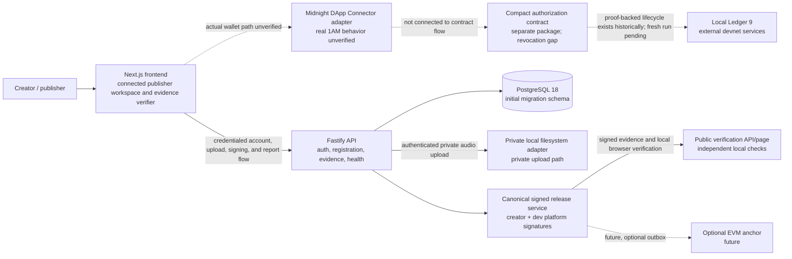
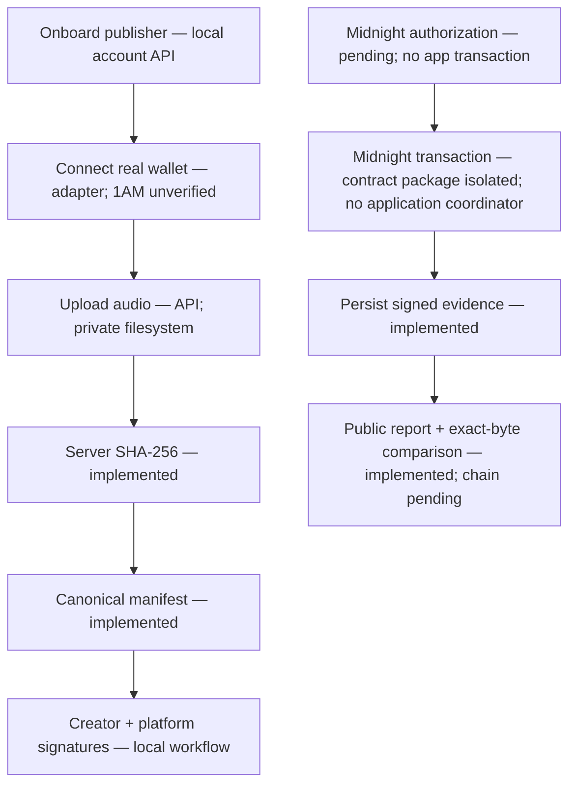
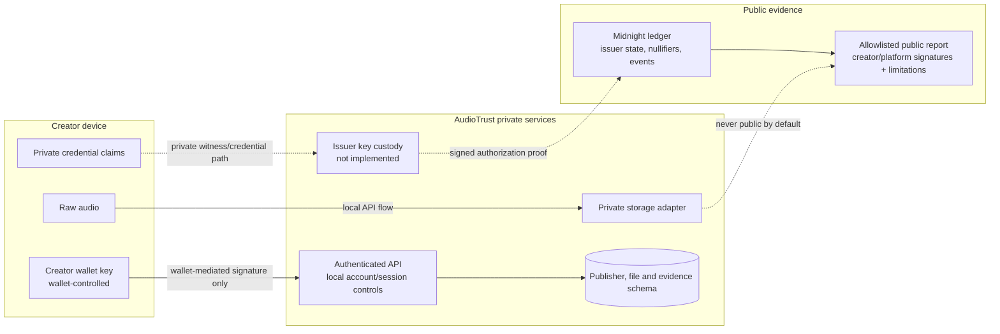

# AudioTrust system architecture

**Updated:** 2026-11-18. This diagram represents repository implementation, not an aspirational product drawing.



Legend: solid lines are implemented paths; dotted lines are incomplete or future paths. Account, upload, signing, and public evidence flows now connect the frontend and API. Midnight transaction submission and live 1AM behavior remain unverified.

## Publisher onboarding and authorization

```mermaid
sequenceDiagram
  participant P as Publisher
  participant UI as Next.js publisher workspace
  participant W as Midnight wallet adapter
  participant API as AudioTrust API
  participant I as BlockTek issuer (future)
  participant C as Compact contract
  P->>UI: Create account and publisher (implemented; email verification pending)
  UI->>W: Discover/connect/sign intent (adapter exists; live 1AM unverified)
  UI->>API: Create durable wallet-bound intent and verify signature
  API->>I: Request publisher credential (not implemented)
  I->>C: Issuer-authorized publisher statement (contract isolated)
  Note over I,C: Current contract revokes a request tuple, not all uses of a credential.
```

## Audio registration lifecycle



## Public verification lifecycle

```mermaid
sequenceDiagram
  participant V as Independent verifier
  participant Web as Public verification page
  participant API as Evidence API
  participant File as Supplied audio file
  V->>Web: Open shareable release URL
  Web->>API: Fetch signed manifest and evidence
  API-->>Web: Allowlisted public report
  V->>Web: Select received audio file
  Web->>File: Calculate SHA-256
  Web->>Web: Compare against signed registered digest
  Note over Web,API: Browser re-verifies manifest and signatures; server records only match/mismatch/time, not the observed mismatch hash.
```

## Trust boundaries and private/public data



## Midnight transaction and DUST flow

```mermaid
sequenceDiagram
  participant UI as Client/wallet
  participant Proof as Compact proof client
  participant Node as Local Ledger 9 services
  participant DB as AudioTrust database
  UI->>Proof: Private witness + circuit inputs (integration pending)
  Proof->>Proof: Generate proof (contract package; current acceptance run required)
  UI->>Node: Submit transaction (no app coordinator)
  Node-->>UI: Finalization and supported event/state evidence
  UI->>DB: Persist actual transaction evidence (not implemented)
  Note over UI,Node: Local devnet DUST flow remains subject to package runbook; no sponsorship API is claimed.
```

## Local development

The host's PostgreSQL 18 service is running but cannot accept the current OS user and cannot be provisioned without interactive administrator authentication. AudioTrust therefore uses a user-owned PostgreSQL 18 cluster, private Unix socket, and port 5440. This avoids modifying the system cluster and does not require an application password for local peer connections. Data is stored outside the repository under the user's local data directory. The application API defaults to loopback only. `scripts/dev-db-up.sh` initializes and starts the cluster and writes ignored `backend/.env.local`; `scripts/dev-db-down.sh` stops that cluster only. The existing Podman/Compose Midnight setup remains separate.

## Components and status

| Component | Status |
|---|---|
| Next.js pages and connected publisher/verifier workflow | Implemented — local only |
| Generic wallet-provider adapter | Implemented — live wallet integration pending |
| Compact authorization package | Implemented — credential-wide revocation security limitation |
| Fastify API, config validation, DB pool, health endpoint | Implemented — verified locally |
| PostgreSQL migrations for accounts, sessions, publishers, audio and evidence | Implemented — applied locally |
| Private local filesystem adapter | Implemented — 3 focused checks pass |
| Auth and publisher onboarding | Implemented — local account/publisher flow; email verification pending |
| Upload, server hashing, nonce, manifest, creator/platform signatures | Implemented — local; creator key/address binding unresolved |
| Public evidence and file comparison | Implemented — browser independently verifies digest/signatures and exact bytes |
| Midnight authorization transaction coordination | Not implemented |
| EVM anchoring | Future extension |
